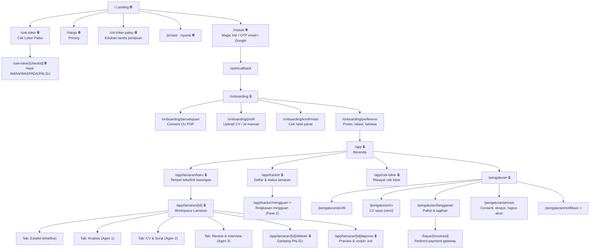
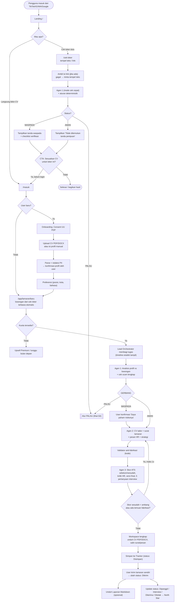
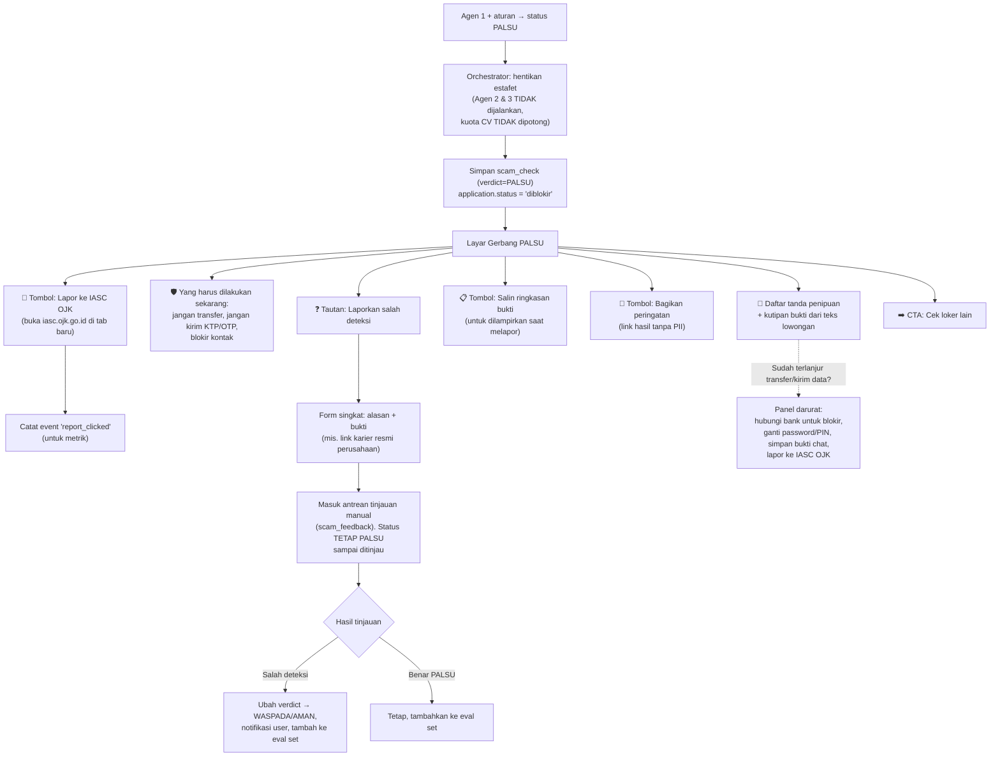
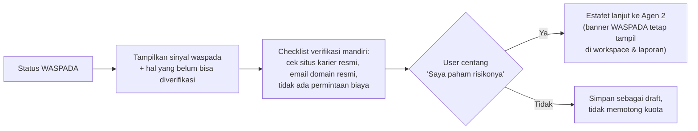
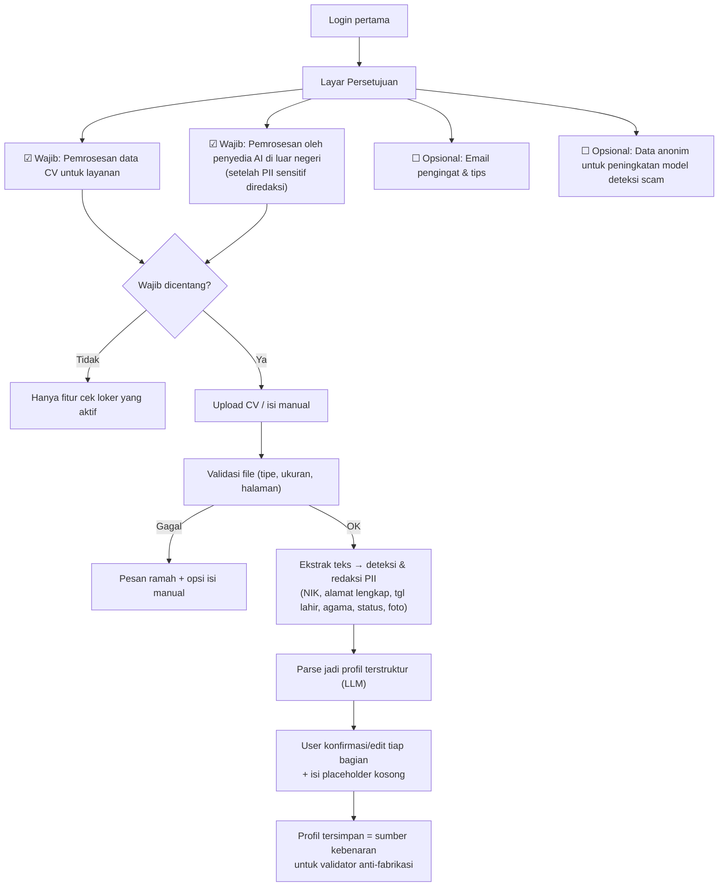
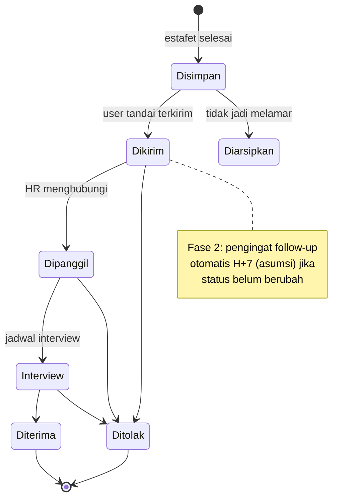

# 02 — Sitemap & User Flow

> Konvensi: 🌐 = publik (tamu), 🔒 = butuh login, ⭐ = fitur Premium/fase berikutnya.

---

## 1. Sitemap

### Daftar halaman

| Path | Akses | Tujuan | MVP? |
|---|---|---|---|
| `/` | 🌐 | Landing: masalah (data latar), cara kerja estafet, CTA "Cek loker sekarang" | ✅ |
| `/cek-loker` | 🌐 | Form tempel teks/link (captcha tak terlihat untuk tamu) | ✅ |
| `/cek-loker/[checkId]` | 🌐 | Hasil cek. Bisa dibagikan lewat link tanpa PII | ✅ |
| `/ciri-loker-palsu` | 🌐 | Konten edukasi (SEO) | ✅ (statis) |
| `/harga` | 🌐 | Paket Gratis / Premium / B2B (waitlist) | ✅ |
| `/privasi`, `/syarat` | 🌐 | Kebijakan privasi & S&K | ✅ |
| `/masuk` | 🌐 | Login/daftar jadi satu | ✅ |
| `/onboarding/*` | 🔒 | Consent → profil → konfirmasi → preferensi | ✅ |
| `/app` | 🔒 | Beranda: kuota, lamaran terakhir, CTA "Lamaran baru" | ✅ |
| `/app/lamaran/baru` | 🔒 | Input lowongan + pilih CV dasar | ✅ |
| `/app/lamaran/[id]` | 🔒 | Workspace estafet (4 tab) | ✅ |
| `/app/lamaran/[id]/diblokir` | 🔒 | Layar gerbang PALSU | ✅ |
| `/app/lamaran/[id]/laporan` | 🔒 | Laporan Markdown | ✅ |
| `/app/tracker` | 🔒 | Tracker Lite (list + ubah status) | ✅ lite |
| `/app/tracker/mingguan` | 🔒 | Ringkasan mingguan | ⭐ Fase 2 |
| `/app/cek-loker` | 🔒 | Riwayat cek loker milik user | ✅ |
| `/pengaturan/*` | 🔒 | Profil, CV, langganan, privasi, notifikasi | ✅ (notifikasi Fase 2) |

---

## 2. User Flow Utama (Happy Path)

---

## 3. Alur saat Loker PALSU

**Aturan alur PALSU:**
- Tidak ada tombol "lanjutkan tetap bikin CV" di MVP (keputusan desain, lihat README).
- Kuota CV pengguna **tidak** dipotong untuk lamaran yang diblokir.
- Pada mode tamu, layar yang sama tampil di `/cek-loker/[checkId]` dengan CTA daftar diganti "Cek loker lain".

---

## 4. Alur WASPADA (ringkas)

---

## 5. Alur Onboarding & Consent

---

## 6. Alur Tracker (MVP Lite → Fase 2)

Status khusus `diblokir` (gerbang PALSU) tidak masuk siklus tracker. Lamaran seperti ini tampil di tab terpisah "Diblokir".
