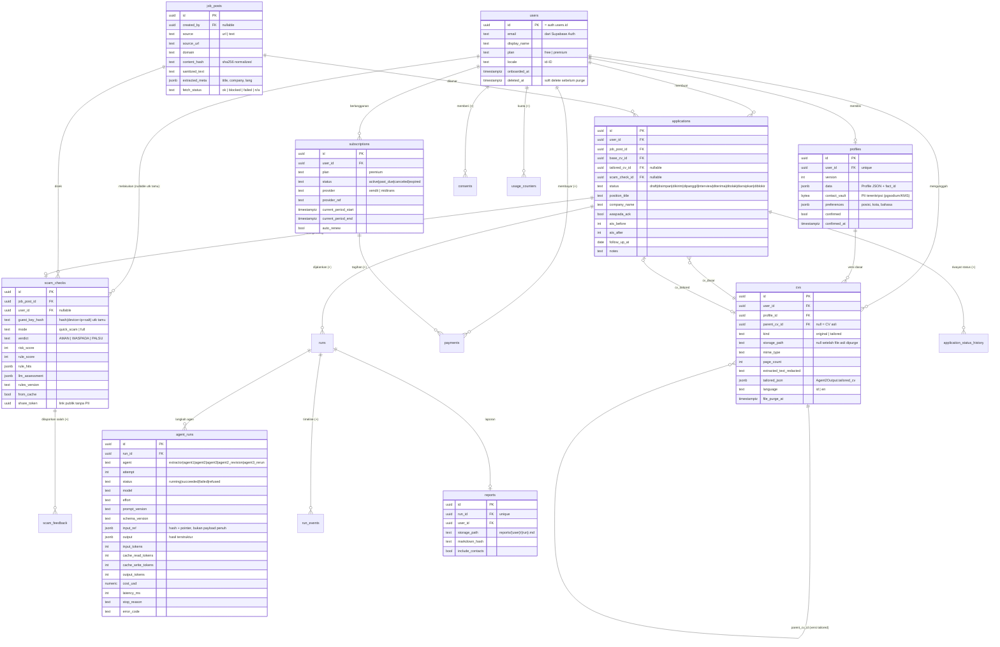

# 05 — Data Model (Supabase Postgres)

> 9 tabel inti sesuai permintaan: `users, profiles, cvs, job_posts, scam_checks, applications, agent_runs, reports, subscriptions`.
> Tabel bertanda **(+)** adalah tambahan yang dibutuhkan agar alur, kepatuhan, dan kuota bisa berjalan.
> Semua tabel memakai `id uuid default gen_random_uuid()`, `created_at timestamptz default now()`, dan **RLS aktif**.

---

## 1. ERD



---

## 2. Definisi Tabel Inti

### 2.1 `users`
Profil akun publik yang mencerminkan `auth.users` (dibuat via trigger `on auth.users insert`).

| Kolom | Tipe | Catatan |
|---|---|---|
| id | uuid PK | = `auth.users.id` |
| display_name | text | Nama panggilan untuk UI (bukan nama lengkap) |
| plan | text | `free` \| `premium` (denormalisasi dari `subscriptions`, diperbarui via webhook) |
| locale | text | default `id-ID` |
| onboarded_at | timestamptz | |
| deleted_at | timestamptz | Diisi saat permintaan hapus akun. Purge permanen oleh cron |

### 2.2 `profiles`
| Kolom | Tipe | Catatan |
|---|---|---|
| user_id | uuid FK unique | |
| version | int | Naik setiap kali user mengedit profil |
| data | jsonb | Tipe `Profile` (04 §4.2). Sumber kebenaran validator |
| contact_vault | bytea | Nama lengkap, email, HP, kota, LinkedIn. **Terenkripsi** (Supabase Vault/pgsodium atau enkripsi aplikasi dengan kunci dari KMS). Tidak pernah dikirim ke LLM |
| preferences | jsonb | `{target_roles[], cities[], remote_ok, cv_language: "auto"\|"id"\|"en", status: "fresh_grad"\|"smk"\|"experienced"}` |
| confirmed / confirmed_at | bool / timestamptz | Agen hanya jalan jika `confirmed=true` |

### 2.3 `cvs`
| Kolom | Tipe | Catatan |
|---|---|---|
| kind | text | `original` (upload) \| `tailored` (hasil Agen 2) |
| parent_cv_id | uuid FK | Tailored → menunjuk CV dasar |
| storage_path | text | Bucket privat `cv-originals/{user_id}/{uuid}.pdf`. **Di-null-kan setelah file dipurge** |
| extracted_text_redacted | text | Teks setelah redaksi PII (dipakai ulang tanpa file asli) |
| tailored_json | jsonb | Untuk render ulang PDF/DOCX **on-demand**. File hasil render tidak disimpan permanen |
| file_purge_at | timestamptz | default `created_at + 30 hari` [ASUMSI] |

### 2.4 `job_posts`
| Kolom | Tipe | Catatan |
|---|---|---|
| created_by | uuid nullable | null untuk tamu |
| content_hash | text, index | Untuk cache & deduplikasi |
| sanitized_text | text | Teks lowongan bersih. Lowongan adalah informasi publik, tetapi kontak perekrut tetap dimasking di tampilan publik |
| fetch_status | text | `ok` \| `blocked` \| `failed` \| `n/a` (teks tempel) |

### 2.5 `scam_checks`
| Kolom | Tipe | Catatan |
|---|---|---|
| user_id / guest_key_hash | | Salah satu terisi. `guest_key_hash = HMAC(salt_harian, device_id + ip/24)` hanya untuk rate limit, **bukan** untuk melacak orang |
| verdict / risk_score / rule_score | | Hasil gerbang final (04 §5.5) |
| llm_assessment | jsonb | `Agent1Output.scam_assessment` |
| from_cache | bool | true jika hasil diambil dari `scam_cache` |
| share_token | uuid | Untuk `/cek-loker/[checkId]`. Halaman publik hanya menampilkan verdict + sinyal + kutipan (kontak dimasking) |

### 2.6 `applications`
| Kolom | Tipe | Catatan |
|---|---|---|
| status | text (enum) | `draft → disimpan → dikirim → dipanggil → interview → diterima/ditolak`, plus `diarsipkan`, `diblokir` |
| waspada_ack | bool | true jika user mengonfirmasi lanjut saat WASPADA |
| ats_before / ats_after | int | Denormalisasi untuk list & metrik |
| follow_up_at | date | Fase 2: pengingat |
| Index | | `(user_id, status)`, `(user_id, updated_at desc)` |

### 2.7 `agent_runs`
Satu baris per **pemanggilan agen** (termasuk retry). Dikelompokkan oleh `run_id` → tabel `runs`.

| Kolom | Catatan |
|---|---|
| input_ref | `{profile_version, job_post_id, content_hash, upstream_agent_run_ids[]}`. Payload input lengkap **tidak** disimpan, cukup direkonstruksi dari referensi |
| output | JSON terstruktur yang tervalidasi. Dipurge 180 hari [ASUMSI]; metrik tetap disimpan |
| cost_usd | Dihitung dari `usage` × tabel harga berversi |

### 2.8 `reports`
| Kolom | Catatan |
|---|---|
| storage_path | Bucket privat `reports/{user_id}/{run_id}.md`. Dibuat on-demand dan bisa dibuat ulang dari `agent_runs` |
| include_contacts | default false |

### 2.9 `subscriptions`
| Kolom | Catatan |
|---|---|
| provider / provider_ref | Xendit atau Midtrans (keputusan K4) |
| auto_renew | MVP: `false` (model "pass bulanan" dibayar manual via QRIS/e-wallet/VA) [ASUMSI] |
| current_period_end | Kuota Premium berlaku hingga tanggal ini |

---

## 3. Tabel Pendukung (+)

| Tabel | Kolom kunci | Fungsi |
|---|---|---|
| `runs` | `application_id, status (state machine 04 §2.3), revision_count, gate_verdict, started_at, finished_at, total_cost_usd` | Satu estafet |
| `run_events` | `run_id, seq, actor, type, title, highlights jsonb, meta jsonb` | Timeline real-time (Supabase Realtime) |
| `application_status_history` | `application_id, from_status, to_status, changed_at, source ('user'\|'system')` | **Sumber data North Star** (transisi ke `dipanggil`/`interview`) |
| `consents` | `user_id, purpose ('cv_processing'\|'ai_cross_border'\|'marketing_email'\|'anon_scam_training'), granted bool, policy_version, granted_at, revoked_at, ip_hash, user_agent` | Bukti persetujuan UU PDP (append-only) |
| `usage_counters` | `user_id, period ('2026-11'), cv_runs_used, scam_checks_used` | Kuota (diupdate atomik di fungsi SQL `consume_quota()`) |
| `payments` | `subscription_id, provider_invoice_id, amount_idr, status, paid_at, raw_webhook jsonb (disaring)` | Tagihan & rekonsiliasi |
| `webhook_events` | `provider, event_id unique, payload_hash, processed_at` | Idempotensi webhook |
| `scam_cache` | `content_hash, rules_version, prompt_version, model, verdict, assessment jsonb, expires_at` | Cache lintas pengguna (tanpa PII) |
| `scam_feedback` | `scam_check_id, user_id, claim ('false_positive'\|'false_negative'), evidence_text, status ('pending'\|'accepted'\|'rejected'), reviewed_by` | Antrean tinjauan manual + bahan eval |
| `audit_logs` | `actor_id, action, entity, entity_id, at, meta` | Akses admin, ekspor data, penghapusan |
| `deletion_requests` | `user_id, requested_at, scheduled_purge_at, completed_at` | Hak hapus data |
| `price_table` | `model, input_per_mtok, output_per_mtok, cache_read_per_mtok, valid_from` | Perhitungan `cost_usd` |

---

## 4. Row Level Security (ringkas)

```sql
-- Pola umum: pemilik hanya bisa akses barisnya sendiri
alter table applications enable row level security;
create policy "own_rows" on applications
  for all using (user_id = auth.uid()) with check (user_id = auth.uid());

-- profiles.contact_vault: tidak pernah di-select dari client; hanya fungsi server (service role) yang mendekripsi
revoke select (contact_vault) on profiles from authenticated;

-- scam_checks publik via share_token → lewat RPC security definer yang mengembalikan kolom aman saja
create function public.get_shared_scam_check(token uuid) returns jsonb
  language sql security definer as $$ ... (verdict, risk_score, red_flags tanpa kontak) $$;

-- agent_runs, run_events: read-only untuk pemilik via join runs → applications.user_id
-- Tabel internal (scam_cache, price_table, webhook_events, audit_logs): tanpa akses client
```

Storage buckets `cv-originals`, `reports`: privat, policy `(storage.foldername(name))[1] = auth.uid()::text`, diakses via **signed URL ≤ 60 detik**.

---

## 5. Retensi & Penghapusan [ASUMSI, keputusan K10]

| Data | Retensi | Mekanisme |
|---|---|---|
| File CV asli | 30 hari setelah upload (atau segera jika user menekan "Hapus file asli") | Cron harian `purge_cv_files` |
| Teks CV teredaksi + profil | Selama akun aktif | Dihapus saat hapus akun |
| `agent_runs.output` | 180 hari, lalu payload dikosongkan (metrik disimpan) | Cron mingguan |
| `scam_checks` tamu | 30 hari | Cron |
| `scam_cache` | TTL 7 hari | Cron |
| `job_posts` tanpa referensi | 90 hari | Cron |
| Hapus akun | Soft delete segera (akses dicabut) → **purge permanen ≤ 14 hari** [ASUMSI] | `deletion_requests` + cron, termasuk Storage |
| `consents`, `audit_logs`, `payments` | Disimpan sesuai kewajiban hukum/perpajakan (tanpa konten CV) | Dianonimkan (user_id → hash) saat akun dihapus |

---

## 6. Fungsi SQL penting

- `consume_quota(user_id, kind)`: atomik (`select … for update`), mengembalikan sisa kuota. Dipanggil **saat run `completed`/`partial`**, bukan saat mulai (cukup dicek di awal).
- `record_status_change(application_id, to_status)`: update `applications` + insert `application_status_history`.
- `weekly_summary(user_id, week)`: (Fase 2) agregasi untuk ringkasan mingguan.
- `north_star(period)`: `count(distinct application_id) where to_status in ('dipanggil','interview')` dibagi pengguna aktif.
