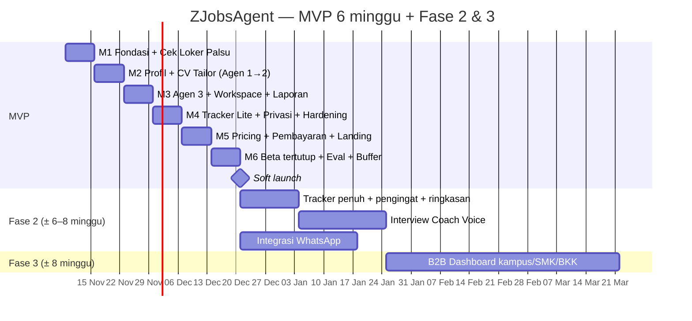

# 08 — Roadmap

> Asumsi tim: **solo developer full-stack + AI coding assistant**, ±40 jam/minggu.
> Tanggal mulai **[ASUMSI] Senin, 9 November 2026** (setelah blueprint disetujui). Jika mundur, geser seluruh jadwal.
> Prinsip: setiap akhir minggu ada sesuatu yang **bisa didemokan/diuji pengguna nyata**.

---

## 1. Gambaran

Jalur kritis MVP: **M1 → M2 → M3** (estafet inti). M4–M5 bisa diringkas jika target 4 minggu (lihat §4).

---

## 2. MVP per Minggu

### Minggu 1 — Fondasi + **Cek Loker Palsu**
**Tujuan:** tamu bisa cek loker dan mendapat AMAN/WASPADA/PALSU dengan bukti, plus gerbang PALSU dan tombol lapor IASC OJK.

| Tugas | Output |
|---|---|
| Setup repo Next.js + TS + Tailwind + shadcn, Supabase (project, migrasi awal), Vercel, Sentry | App kosong ter-deploy |
| Migrasi tabel: `job_posts`, `scam_checks`, `scam_cache`, `scam_feedback`, `users`, `consents` + RLS | Skema awal |
| `lib/ingest`: fetcher aman (anti-SSRF, robots, limit) + sanitasi + fallback tempel | Unit test |
| `lib/scam/rules.ts` (R01–R11) + `gate.ts` | Unit test ≥ 30 kasus |
| Agen 1 mode `quick_scam`: prompt v1, skema Zod, `client.ts` (retry, refusal, cost) | Panggilan berjalan |
| UI: `/cek-loker`, `/cek-loker/[checkId]` (W2, W3a, W3b), Turnstile, rate limit Upstash | Bisa dipakai di HP |
| Mulai kumpulkan `scam_eval` (target 50 contoh dulu) | Dataset v0 |
| **Validasi:** 5 wawancara singkat pengguna target (persona B & A) | Catatan insight |

**Definition of Done:** 10 contoh loker (5 palsu, 5 asli) diuji manual dari HP: semua PALSU terdeteksi, dan tidak ada loker asli yang ditandai PALSU.

### Minggu 2 — Auth, Profil, **CV Tailor** (Agen 1 full → Gerbang → Agen 2)
| Tugas | Output |
|---|---|
| Supabase Auth (OTP email + Google), `/masuk`, onboarding consent (W4–W5) | Login jalan |
| Upload CV (signed URL, validasi magic bytes), parse PDF/DOCX, **redaksi PII**, `contact_vault` | Pipeline CV |
| Profile Extractor + layar konfirmasi profil (W6–W7) | Profil `confirmed` |
| Inngest + `orchestrate-run` (state machine sampai Agen 2), `runs`, `run_events`, `agent_runs` | Estafet durable |
| Agen 1 mode full + Agen 2 + **validator anti-fabrikasi** (V1–V7) | Unit test validator |
| Render CV **DOCX + PDF** dari `tailored_json` | Unduh berfungsi |
| Timeline estafet real-time (W10) via Supabase Realtime | UI timeline |
| **Ukur** token & biaya nyata per langkah → perbarui 04 §9 | Angka biaya aktual |

**DoD:** dari HP, user baru bisa login, upload CV, konfirmasi profil, menempel lowongan, lalu mengunduh CV tailored (PDF/DOCX) tanpa fabrikasi pada 10 pasangan uji.

### Minggu 3 — **Agen 3**, Workspace lengkap, Laporan
| Tugas | Output |
|---|---|
| Agen 3 (rubrik, kritik HR, integrity notes, 5 pertanyaan interview) | Prompt v1 |
| `lib/ats/score.ts` (KeywordCoverage + FormatParseability) + skor sebelum/sesudah | Unit test |
| Loop revisi maks 1x + alur WASPADA `awaiting_ack` | State machine lengkap |
| Workspace 4 tab (W10–W13), editor placeholder `[isi: …]` | UI lengkap |
| Report builder Markdown (04 §12) + halaman laporan (W14) | Unduh `.md` |
| Penanganan error lengkap (04 §10): retry, partial, needs_input | Uji fault-injection |
| `tailor_eval` v0 (15 pasangan) + `injection_eval` v0 (10 kasus) | Skrip eval |
| **Validasi:** uji usability 5 pengguna (timeline transparan, latensi) | Temuan UX |

**DoD:** estafet penuh berjalan end-to-end. Laporan berisi 4 bagian wajib. 0 fabrikasi di `tailor_eval`.

### Minggu 4 — **Tracker Lite**, Kuota, Privasi, Hardening
| Tugas | Output |
|---|---|
| Tracker Lite (W15): list, filter, ubah status + `application_status_history` | North Star terukur |
| Beranda app (W8), riwayat cek loker | |
| `usage_counters` + `consume_quota()` (3 CV/bulan gratis), fair-use cek loker | Kuota |
| Halaman privasi (W17): ekspor `.zip`, hapus file CV, hapus akun, cabut consent | Hak subjek data |
| Cron purge retensi (05 §5) | Otomatis |
| Security hardening: CSP, header, scrubber Sentry, review RLS, `gitleaks` | Checklist 07 |
| Event analytics PostHog (funnel + North Star) | Dashboard |

**DoD:** checklist 07 §2 C1–C5, C7, C11–C13 terpenuhi. Pengguna bisa menghapus akun dan semua datanya terhapus (diverifikasi).

### Minggu 5 — Pricing, **Pembayaran**, Landing
| Tugas | Output |
|---|---|
| Integrasi Xendit/Midtrans (K4): checkout pass bulanan, webhook idempoten, `subscriptions`, `payments` | Premium aktif |
| `/harga` (W16) + upsell saat kuota habis | |
| Landing page (W1) dengan data latar + `/ciri-loker-palsu` (SEO) | |
| Kebijakan privasi & S&K (draf → review hukum) | |
| Fake-door/pre-order untuk validasi harga Rp29rb vs Rp49rb (A5) | Data WTP |

**DoD:** transaksi sandbox → Premium aktif → kuota bertambah. Refund/expire teruji.

### Minggu 6 — Beta Tertutup, Eval, Buffer
| Tugas | Output |
|---|---|
| Beta tertutup 20–50 pengguna [ASUMSI] (komunitas kampus/SMK/grup loker) | Feedback nyata |
| Lengkapi `scam_eval` ≥100, `tailor_eval` ≥30, `injection_eval` ≥20; tuning ambang gerbang & prompt v2 | Metrik lulus 04 §11 |
| Keputusan model final per agen berdasarkan eval + biaya aktual (K1) | Konfigurasi produksi |
| DPIA final + review hukum UU PDP & PP 33/2026 (K15) | Dokumen |
| Bug fix, performa (Lighthouse mobile), runbook insiden | Siap soft launch |

**DoD soft launch:** eval lulus, review hukum selesai, biaya per estafet ≤ target (K1), tidak ada bug P0.

---

## 3. Fase 2 (± 6–8 minggu setelah MVP)

| Fitur | Cakupan | Catatan teknis |
|---|---|---|
| **Tracker penuh** | Kanban, tanggal follow-up, pengingat email (Resend) H+7 [ASUMSI], template pesan follow-up, **ringkasan mingguan** (email + halaman), prompt "Sudah ada kabar?" untuk meningkatkan kelengkapan North Star | Cron + `weekly_summary()` |
| **Interview Coach Voice** | Latihan interview suara: pertanyaan dari Agen 3 → user menjawab via mic → transkripsi → feedback (struktur STAR, kejelasan, durasi) | Pilih vendor STT/TTS yang mendukung Bahasa Indonesia (evaluasi kualitas & biaya). Consent tambahan untuk rekaman suara (data baru di DPIA). Audio tidak disimpan setelah ditranskripsi |
| **WhatsApp** | (a) Forward teks loker ke nomor ZJobsAgent → balasan verdict; (b) notifikasi status/pengingat | WhatsApp Business Platform (Cloud API / BSP). Template pesan disetujui Meta. Biaya per percakapan dimasukkan ke unit economics. Rate limit per nomor |
| Lainnya | OCR untuk CV hasil scan, multi-template CV, riwayat versi CV, pemindai malware file, OTP via WA | |

## 4. Fase 3 — B2B Dashboard Kampus/SMK/BKK (± 8 minggu)

| Fitur | Catatan |
|---|---|
| Multi-tenant (`organizations`, `org_members`, `org_invites`), lisensi kursi | Tabel & RLS per org |
| Dashboard **penyerapan lulusan**: agregat status lamaran (dikirim → dipanggil → diterima) per angkatan/jurusan | **Hanya agregat** dengan ambang minimum anonimitas (mis. sel < 5 disembunyikan [ASUMSI]). Consent eksplisit alumni untuk berbagi data ke institusi |
| Peringatan loker palsu yang beredar di kalangan alumni | Dari `scam_checks` agregat |
| Ekspor laporan untuk akreditasi/BKK | Perlu validasi kebutuhan dengan 3–5 institusi pilot |
| Kontrak & DPA dengan institusi | Institusi bisa berperan sebagai pengendali data. Perlu kajian hukum |

---

## 5. Opsi MVP 4 Minggu (jika dipercepat)
Gabungkan M4+M5 menjadi satu minggu dan pindahkan **pembayaran** ke pasca-launch (Premium dimulai sebagai waitlist/fake-door). Beta tertutup berjalan paralel di minggu 4. Risiko: waktu eval & hardening berkurang. **Tidak disarankan** untuk melewati eval anti-fabrikasi dan review privasi.

## 6. Risiko Jadwal

| Risiko | Mitigasi |
|---|---|
| Fetch link portal sering gagal (login wall) | Fallback tempel teks sudah di MVP. Ukur tingkat keberhasilan per domain |
| Kualitas parse CV PDF beragam | Layar konfirmasi profil + isi manual |
| Biaya token lebih tinggi dari estimasi | Ukur di minggu 2. Keputusan K1 diambil di minggu 6 berbasis data |
| Review hukum lama | Mulai kontak konsultan di minggu 3 |
| Solo dev burnout / scope creep | Fitur Fase 2 dikunci. Buffer di minggu 6 |
